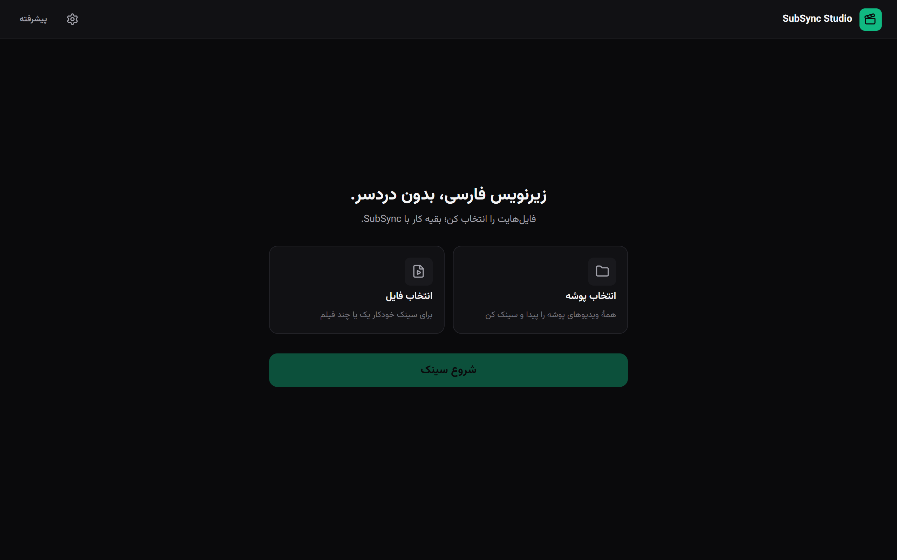

<div align="center">

# 🎬 SubSync Studio

**زیرنویس فارسی، بدون دردسر — استخراج، دانلود و همگام‌سازی خودکار زیرنویس فارسی برای سریال‌ها و فیلم‌های شما**

*Automatic Persian subtitle extraction, downloading and syncing for your movies & series — on Windows, with zero manual work.*

[](https://github.com/Imanemoon/persian-subtitle-studio/releases/latest)
[](https://github.com/Imanemoon/persian-subtitle-studio/releases/latest)
[](https://github.com/Imanemoon/persian-subtitle-studio/actions/workflows/ci.yml)
[](LICENSE)
[](#نصب)

</div>

---

SubSync Studio یک برنامهٔ دسکتاپ ویندوزی است که کل چرخهٔ زیرنویس فارسی را خودکار می‌کند:
زیرنویس داخلی ویدیو را استخراج می‌کند، اگر نبود از **SubSource** دانلود می‌کند، آرشیوهای
زیرنویس را با قسمت تطبیق داده و استخراج می‌کند، و در نهایت زیرنویس را با **FFsubsync** روی
صدای ویدیو **همگام‌سازی** و کنار فیلم جانمایی می‌کند — همه‌چیز با چند کلیک و با جایگزینی
مدرن و گرافیکی برای خط لولهٔ دستی PowerShell + FFmpeg + SubSource + 7-Zip + FFsubsync.

> **English:** A Windows desktop app that automates the whole Persian-subtitle workflow:
> extract embedded tracks, download from SubSource, match & extract subtitle archives,
> sync timing with FFsubsync, and place the final `<name>.fa.synced.srt` next to your videos.

| راه‌اندازی اولین اجرا (پیش‌نیازها خودکار نصب می‌شوند) | نتیجهٔ اجرا |
| :---: | :---: |
|  |  |



## ✨ قابلیت‌ها

### معاونت راه‌اندازی خودکار
- ffmpeg، Python و FFsubsync با یک کلیک دانلود و نصب می‌شوند — per-user، بدون admin،
  با **تأیید SHA256 پین‌شده** و progress واقعی؛ هیچ نصب دستی لازم نیست
- 7-Zip و کلاینت SubSource داخل نصاب باندل شده‌اند
- افزودن یک‌کلیکی پوشه‌ها به استثناهای Windows Defender (شتاب واقعی روی هارد) و
  ساخت میان‌بر «Run as administrator»

### استخراج زیرنویس داخلی
- تحلیل با FFprobe: کدک، زبان، عنوان و Disposition هر Subtitle Stream
- تشخیص فارسی دو لایه: اول tag/عنوان Track (fa/fas/per/farsi/persian/فارسی)، بعد
  **تأیید محتوای واقعی** با رنج‌های یونیکد فارسی — tag فارسی با متن لاتین حساب نمی‌شود
- چند Track فارسی → انتخاب صریح کاربر؛ Track بدون برچسب → بررسی آزمایشی محتوا؛
  زیرنویس تصویری (PGS/VobSub/DVB) → پیام صریح نیاز به OCR
- استخراج امن: فایل موقت → اعتبارسنجی (ساختار cue + شمارش فارسی) → انتقال اتمیک به
  `<base>.fa.srt` — **بدون هیچ بازنویسی**
- زیرنویس‌های موجود skip می‌شوند (با دلیل)، لغو، فرایند FFmpeg را می‌کشد و فایل موقتش را پاک می‌کند

### دانلود از SubSource و آرشیوها
- کلید API اختیاری است — **بدون کلید هم دانلود ناشناس کار می‌کند**؛ کلید شخصی فقط در **Credential Manager ویندوز**، هرگز در فایل تنظیمات یا کد
- Staging امن با Hard Link، بازبینی تازهٔ فایل‌سیستم، کدهای skip تایپ‌شده
- پلن آرشیو دو مرحله‌ای: بازرسی امن همهٔ اعضا → استخراج → تطبیق اپیزود → جانمایی؛
  تعارض = هر دو فایل حفظ می‌شوند

### همگام‌سازی با ffsubsync
- فراخوانی multi-segment با skip-intro-outro و محافظت کیفیت پایین (`--skip-sync-on-low-quality`)
- کد خروج 0 همیشه «موفق» نیست — طبقه‌بندی fail-closed روی marker آفست؛ آفست اعتبارسنجی‌شده در UI نمایش داده می‌شود
- workspace موقت مقیدشده (بدون فرار از ریشه، بدون بازنویسی ورودی‌ها)

### pipeline یک‌پارچه با شفافیت کامل
- ۱۲ مرحله با موانع (barrier) — در حالت تعاملی، هرجا ابهام باشد برنامه می‌ایستد و با دیالوگ از شما می‌پرسد
- هر پیشرفت، شمارش و نتیجه از دادهٔ واقعی بک‌اند می‌آید — **هیچ درصد یا موفقیتی ساختگی نیست**
- لغو امن در هر لحظه؛ وضعیت run پس از reload صفحه تا وقتی برنامه در حال اجراست بازسازی
  می‌شود — پس از بستن برنامه، اجرای نیمه‌تمام از سر گرفته نمی‌شود (گزارش JSON فقط
  گزارش است، نه resume)؛ تعارض‌ها و خطاها با دلیل صادقانه

### پردازش کامل خودکار (حالت جدید)
- سوییچ «تعاملی / پردازش کامل خودکار» روی صفحهٔ خانه — پیش‌فرض همان رفتار تعاملی است
- در حالت خودکار، موتور pipeline تصمیم‌های عادی را خودش می‌گیرد و فقط موارد
  نامطمئن به وضعیت صادقانهٔ **«نیازمند بررسی»** می‌روند — هرگز حدسِ کم‌اطمینان نمی‌زند
- **امتیازدهی Track فارسی**: بین چند کاندیدا با متریک‌های قابل‌اندازه‌گیری انتخاب
  می‌شود — تراکم حروف فارسی، پوشش زمانی نسبت به طول ویدیو، سلامت cue
  (خالی/تکراری/تبلیغ‌مانند) و بونوس کوچک tag؛ tag فارسی به‌تنهایی هرگز کافی نیست
  و امتیاز فقط برای ترتیب‌دهی است، نه «درصد اطمینان»
- **سینک تطبیقی با سقف تلاش**: نردبان استراتژی‌ها تا سقف قابل‌تنظیم اجرا و بهترین
  کاندیدای تأییدشده با شواهد کیفیت انتخاب می‌شود — توافق آفست دو تلاش مستقل
  قوی‌ترین شاهد است؛ گیت کیفیت ۳۰ ثانیه‌ای در هر دو حالت پابرجاست و رکورد همهٔ
  تلاش‌ها در جزئیات هر فایل دیده می‌شود
- **گزارش JSON هر اجرا** در `%ProgramData%\SubSync Studio\data\runs` — نتیجهٔ هر
  فایل، دلایل تصمیم‌های خودکار و تلاش‌های سینک؛ اتمیک و بدون بازنویسی

### پروفایل‌های پردازش
- هر پروفایل مجموعهٔ «پردازش و سینک + اتوماسیون + نام‌گذاری خروجی» را نگه می‌دارد و
  با یک کلیک روی مقادیر فعلی **اعمال** می‌شود — ایجاد، تکثیر، تغییر نام و حذف از
  تنظیمات؛ انتخاب سریع پروفایل فعال روی صفحهٔ خانه
- شناسهٔ پروفایل قطعی و backend-owned است (نام هرگز شناسه نیست)؛ پروفایل
  پیش‌فرض «پیش‌فرض» ساختی است و قابل حذف نیست — برنامه همیشه یک پیکربندی
  قابل استفاده دارد
- تنظیمات سراسری (ابزارها، پوشه‌ها، اعلان‌ها، کلید API و…) خارج از پروفایل‌اند؛
  هیچ تنظیم امنیتی داخل پروفایل تکرار نمی‌شود
- مهاجرت خودکار: کاربران نسخه‌های قبلی یک پروفایل پیش‌فرض از مقادیر مؤثر خودشان
  می‌گیرند — هیچ رفتاری بدون اجازه عوض نمی‌شود
- هر run پروفایل فعال را در شروع، به‌صورت snapshot، ثبت می‌کند؛ تغییر تنظیمات
  وسط اجرا روی run جاری اثر ندارد و در گزارش JSON هم ثبت می‌شود

### قالب نام خروجی
- قالب فقط **بخش پایهٔ نام** خروجی sidecar سینک‌شده را می‌سازد؛ پسوند قراردادی
  `.fa.synced.srt` همیشه حفظ می‌شود تا تشخیص فارسی در اجراهای بعدی کار کند
- پلاسهولدرهای مجاز: `{name}` نام ویدیو، `{show}` نام نمایشی سریال، `{season}`
  فصل (دورقمی)، `{episode}` قسمت (دورقمی)، `{parent}` نام پوشه — عمداً محدود
  به متادیتایی که اسکن واقعاً دارد؛ خروجی SoftSub در-جاست و قالب نمی‌گیرد
- اگر متادیتای یک پلاسهولدر برای ویدیویی نباشد (مثلاً `{episode}` برای فیلم)،
  خروجی **قطعی** به نام خود ویدیو برمی‌گردد — هیچ براکت خامی در نام نمی‌نشیند
- قالب‌ها در زمان ذخیره اعتبارسنجی می‌شوند (پلاسهولدر ناشناخته/براکت باز/
  کاراکتر ممنوع ویندوز → خطای صریح) و رندر نهایی هم لایهٔ دفاعی دارد:
  جداکنندهٔ مسیر و کاراکترهای ممنوع حذف، نام رزرو ویندوز پیشوند امن می‌گیرد،
  طول محدود می‌شود — خروجی همیشه داخل همان پوشهٔ ویدیو است
- تعارض با فایل موجود از مسیر no-overwrite موجود می‌گذرد: هر دو فایل حفظ
  می‌شوند و هیچ‌چیز بازنویسی نمی‌شود؛ پیش‌نمایش قطعی نام در تنظیمات با نمونهٔ نماینده

### ویرایشگر زیرنویس (فاز ۳)
- از هدر برنامه: بازکردن فایل SRT، ویرایش متن/شروع/پایان هر cue، افزودن/حذف
  cue، جستجو در متن، و ذخیره در فایل جدید `<name>.edited.srt` — فایل اصلی
  هرگز بازنویسی نمی‌شود
- **فقط SRT**؛ متن یونیکد و RTL و خط‌بندی چندخطی حفظ می‌شود؛ شماره‌گذاری
  هنگام ذخیره به ۱..n نرمال می‌شود
- اعتبارسنجی fail-closed: مدت صفر/منفی و ترتیب واژگون ذخیره را رد می‌کنند؛
  هم‌پوشانی و متن خالی هشدارند — هیچ محتوایی بی‌صدا حذف نمی‌شود
- فایل cp1256/ANSI فارسی در ویرایشگر باز نمی‌شود — ابتدا از «تبدیل encoding»
  (همان صفحه) به UTF-8 تبدیل کنید؛ خروجی فایل جدید است و اصل حفظ می‌شود
- encoding پشتیبانی‌شده برای تشخیص: UTF-8، UTF-8 BOM، UTF-16 LE/BE و
  Windows-1256 فقط با حداقل ۱۰ حرف فارسی (همان گیت مسیر دانلود)؛ بایت‌های
  مبهم هرگز به فارسی تفسیر نمی‌شوند و با دلیل صادقانه رد می‌شوند

### تایپوگرافی هاردساب (فاز ۳)
- در تنظیمات: فونت سفارشی (نام خانواده + فایل فونت ttf/otf/ttc)، اندازه، رنگ
  متن/خط دور با فرمت ASS `&H[AA]BBGGRR`، ضخامت خط دور، سایه و حاشیهٔ عمودی
- خاموش (پیش‌فرض) = دقیقاً رفتار فعلی؛ روشن = force_style با مقادیر اعتبارسنجی‌شده
- با انتخاب **فایل فونت**، مسیر پوشه‌اش به ffmpeg داده می‌شود و نتیجهٔ فونت
  قطعی است؛ بدون فایل، libass از فونت‌های نصب سیستم جستجو می‌کند و اگر
  خانواده نباشد **بی‌صدا به پیش‌فرض برمی‌گردد** (از خروجی ffmpeg قابل‌تشخیص
  نیست — صادقانه مستند شده؛ نتیجهٔ قطعی فقط با فایل فونت)
- RTL و اتصال حروف فارسی توسط libass داخل ffmpeg (HarfBuzz+FriBidi)
  انجام می‌شود — هیچ معکوس‌سازی دستی متنی وجود ندارد؛ متن خام پاس می‌شود.
  کیفیت رندر به build فونت‌های ffmpeg بستگی دارد و ما در اینجا ادعای
  فراتر از آن نمی‌کنیم
- نام فونت با کاراکترهای خطرناک (کوتیشن/کاما/بک‌اسلش/…) در save رد می‌شود
  تا فیلتر ffmpeg هرگز خراب نشود؛ fallback انکودر GPU→CPU دست‌نخورده است
- تایپوگرافی داخل پروفایل‌ها هم هست و با snapshot شروع هر hardsub قفل می‌شود

## 📥 نصب

۱. آخرین نصاب را از [**Releases**](https://github.com/Imanemoon/persian-subtitle-studio/releases/latest)
   دانلود کنید (`SubSync Studio_x.y.z_x64-setup.exe`)
۲. نصب کنید — نصاب کوچک است؛ **بار اول که برنامه باز شود، صفحهٔ راه‌اندازی همهٔ
   پیش‌نیازها را خودش دانلود و نصب می‌کند**
۳. (پیشنهادی) در همان صفحه، پوشهٔ رسانه‌های‌تان را به استثناهای Defender اضافه کنید —
   روی هارد دیسک مکانیکی چند برابر سریع‌تر می‌شود
۴. (اختیاری) کلید API حساب شخصی SubSource را در تنظیمات ذخیره کنید — بدون کلید هم دانلود ناشناس کار می‌کند

**پیش‌نیاز سیستم:** Windows 10/11 (64-bit) — اگر WebView2 نصب نباشد، نصاب آن را دانلود می‌کند.

<details>
<summary><b>ترتیب پیدا شدن ابزارها</b> (برای کاربران حرفه‌ای)</summary>

1. مسیرهای ست‌شده در «تنظیمات → ابزارهای خارجی»
2. مسیرهای نصب‌شده توسط معاونت راه‌اندازی (`%LOCALAPPDATA%\com.subsync.studio\tools`)
3. PATH سیستم و مسیرهای استاندارد (`Program Files\7-Zip`، `%LOCALAPPDATA%\Programs\SubSource`)

</details>

## 🛠 ساخت از سورس

پیش‌نیاز: Node 20+، Rust stable (MSVC) — NSIS به‌صورت خودکار توسط tauri-cli دانلود می‌شود.

```bash
cd frontend && npm install   # وابستگی‌های فرانت‌اند (یک‌بار)
cd ..
npm run tauri dev     # اجرای توسعه
npm run tauri build   # نصاب ریلیز → src-tauri/target/release/bundle/nsis/
```

تست‌ها:

```bash
cd src-tauri
cargo test                     # unit + integration (بدون نیاز به شبکه/کلید)
cargo test -- --ignored       # تست‌های زنده (ابزارهای واقعی لازم دارند)
cargo clippy --all-targets    # صفر warning هدف پروژه است
```

## 🧱 تکنولوژی

- **Backend:** Rust + Tauri 2 — هسته‌های مستقل از Tauri با callback تزریق‌پذیر، admission
  اتمیک عملیات (RAII)، workspace موقت مقیدشده، fail-closed در همهٔ مرزها
- **Frontend:** React 19 + TypeScript + Tailwind CSS v4 — RTL کامل با فونت وزیرمتن؛
  همهٔ اعداد و وضعیت‌ها فقط از بک‌اند
- **امنیت:** دانلودها با SHA256 پین‌شده تأیید می‌شوند، کلید API فقط در Credential Manager،
  هیچ عمل elevated بدون رضایت صریح کاربر اجرا نمی‌شود

## 📦 اجزای باندل‌شده

| جزء | منبع |
|---|---|
| `sub-rs.exe` (کلاینت دانلود SubSource) | باینری این پروژه |
| `7z2603-x64.exe` | نصاب رسمی [7-Zip](https://www.7-zip.org/) (LGPL) |
| `ffmpeg` / `python` / `ffsubsync` | **باندل نمی‌شوند** — در زمان اجرا از منابع رسمی با نسخهٔ پین‌شده و SHA256 دانلود می‌شوند |

## 🗺 نقشهٔ راه

- [x] فاز ۱ — اسکن واقعی پوشه‌ها، تشخیص اپیزود، داشبورد، تشخیص ابزارها، تنظیمات
- [x] فاز ۲ — موتور زیرنویس: FFprobe، استخراج، تشخیص محتوای فارسی
- [x] فاز ۳ — دانلود SubSource، آرشیوها، سینک ffsubsync، pipeline انتها-به-انتها
- [x] فاز ۴ — نصاب ویندوز + معاونت راه‌اندازی خودکار پیش‌نیازها
- [ ] OCR برای زیرنویس تصویری (PGS/VobSub)
- [ ] ویرایشگر زیرنویس و زمان‌بندی دستی

## 📄 لایسنس و تغییرات

- لایسنس: [MIT](LICENSE) — ffmpeg به‌صورت runtime دانلود می‌شود، نه باندل
- تاریخچهٔ نسخه‌ها: [CHANGELOG](docs/CHANGELOG.md)
- گزارش آسیب‌پذیری: [.github/SECURITY.md](.github/SECURITY.md)

## 🇬🇧 Features (English)

SubSync Studio is a **free & open-source Windows desktop app** that automates Persian (Farsi)
subtitles for your entire video library:

- **Extract embedded Persian subtitles** from MKV/MP4 — dual-layer Persian detection
  (language tag + real content verification), multi-track selection, review for untagged tracks
- **Download Persian subtitles from SubSource.org** — works anonymously out of the box
  (optional personal API key stored only in Windows Credential Manager), safe staging with hard links
- **Match & extract subtitle archives** (zip/rar/7z) with episode matching and conflict preservation
- **Sync subtitle timing with FFsubsync** — multi-segment alignment, intro/outro skip,
  low-quality protection, validated offset shown in the UI
- **Fully automatic mode** — one switch on the home screen: the backend policy layer
  resolves safe decisions with explainable Persian-track scoring (density, duration
  coverage, cue health) and sends only genuinely uncertain cases to an honest
  "Needs review" state; bounded sync retries pick the best validated candidate by
  quality evidence (agreement first, never just the smallest offset), and every batch
  writes a JSON report under the persistent data directory
- **Processing profiles** — reusable named sets of processing/automation/naming
  choices with backend-owned stable IDs; create, duplicate, rename, apply and delete
  from Settings, quick-switch on Home. A built-in default profile can never be
  deleted, existing users are migrated with a snapshot of their own effective values,
  and each run captures a profile snapshot at start (mid-run setting changes never
  affect a running job — also recorded in the batch report)
- **Output naming templates** — intentionally limited placeholders (`{name}`, `{show}`,
  `{season}`, `{episode}`, `{parent}`) that only build the base name of the synced
  sidecar output; the `.fa.synced.srt` suffix is always preserved so Persian detection
  keeps working on re-runs. Missing metadata deterministically falls back to the video
  name, templates are validated on save, the renderer strips path separators and
  Windows-reserved names, output always stays inside the video's own folder, and
  collisions go through the existing no-overwrite policy
- **Subtitle editor** — SRT editing with cue text/timestamp edits, add/delete, search
  and live backend validation (invalid durations and out-of-order starts block save;
  overlaps and empty text are honest warnings). Save always goes to a new
  `<name>.edited.srt` file — the original is never touched. cp1256/ANSI files must be
  converted to UTF-8 first (built-in one-click conversion on the same page, writing a
  new `.utf8.srt` file alongside the untouched original)
- **Local encoding detection & conversion** — confident detection of UTF-8 / UTF-8 BOM /
  UTF-16 LE/BE and Windows-1256 (gated on ≥10 Persian characters, the same gate as the
  download path); ambiguous byte sequences are reported honestly and never reinterpreted
  as Persian. Conversion re-encodes bytes only (cue structure and timestamps preserved
  byte-for-byte), writes atomically to a new `.utf8.srt` file and never overwrites
- **HardSub typography** — configurable font family (with font file for a deterministic
  result), size, ASS `&H[AA]BBGGRR` colors, outline, shadow and vertical margin, applied
  through libass `force_style` with strict save-time validation (dangerous font-name
  characters rejected so the ffmpeg filter can never break). RTL/bidi/shaping is done by
  libass inside ffmpeg — no manual text reversal. Off by default: exact previous behavior
- **Place `<name>.fa.synced.srt` next to each video** — strict no-overwrite policy
- **First-run setup wizard** auto-installs all prerequisites (ffmpeg, Python, ffsubsync —
  version-pinned, SHA256-verified, per-user, no admin required)
- **Honest progress everywhere** — every number and status comes from the backend; fake
  percentages don't exist in this codebase
- **Safe by design** — atomic operations, workspace confinement, no-overwrite placement,
  cancel anything at any time; run state reconnects on UI reload while the app is
  running — a closed run is not resumed (the JSON batch report is a record, not a resume)

It is the modern GUI replacement for the manual
*PowerShell + FFmpeg + SubSource CLI + 7-Zip + FFsubsync* pipeline.
Built with **Tauri 2 + Rust + React 19**, full RTL Persian UI (Vazirmatn font), MIT licensed.

Keywords: persian subtitles, farsi subtitle sync, ffsubsync gui, subsource downloader,
subtitle extractor, automatic subtitle sync, tauri desktop app, rust subtitle tool.
