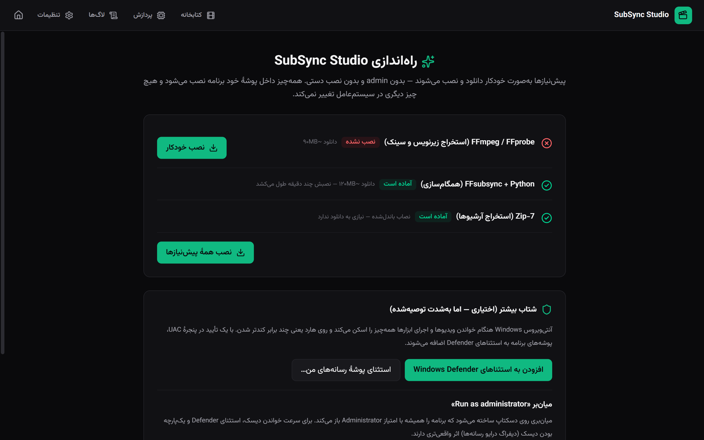
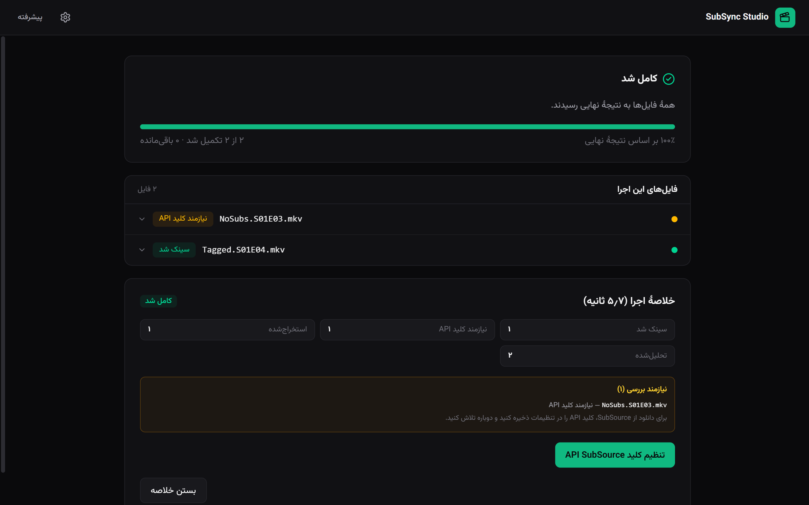

<div align="center">

# 🎬 SubSync Studio

**زیرنویس فارسی، بدون دردسر — استخراج، دانلود و همگام‌سازی خودکار زیرنویس فارسی برای سریال‌ها و فیلم‌های شما**

*Automatic Persian subtitle extraction, downloading and syncing for your movies & series — on Windows, with zero manual work.*

[](https://github.com/Imanemoon/persian-subtitle-studio/releases/latest)
[](https://github.com/Imanemoon/persian-subtitle-studio/releases/latest)
[](https://github.com/Imanemoon/persian-subtitle-studio/actions/workflows/ci.yml)
[](LICENSE)
[](#نصب)

</div>

---

SubSync Studio یک برنامهٔ دسکتاپ ویندوزی است که کل چرخهٔ زیرنویس فارسی را خودکار می‌کند:
زیرنویس داخلی ویدیو را استخراج می‌کند، اگر نبود از **SubSource** دانلود می‌کند، آرشیوهای
زیرنویس را با قسمت تطبیق داده و استخراج می‌کند، و در نهایت زیرنویس را با **FFsubsync** روی
صدای ویدیو **همگام‌سازی** و کنار فیلم جانمایی می‌کند — همه‌چیز با چند کلیک و با جایگزینی
مدرن و گرافیکی برای خط لولهٔ دستی PowerShell + FFmpeg + SubSource + 7-Zip + FFsubsync.

> **English:** A Windows desktop app that automates the whole Persian-subtitle workflow:
> extract embedded tracks, download from SubSource, match & extract subtitle archives,
> sync timing with FFsubsync, and place the final `<name>.fa.synced.srt` next to your videos.

| راه‌اندازی اولین اجرا (پیش‌نیازها خودکار نصب می‌شوند) | نتیجهٔ اجرا |
| :---: | :---: |
|  |  |


## ✨ قابلیت‌ها

### معاونت راه‌اندازی خودکار
- ffmpeg، Python و FFsubsync با یک کلیک دانلود و نصب می‌شوند — per-user، بدون admin،
  با **تأیید SHA256 پین‌شده** و progress واقعی؛ هیچ نصب دستی لازم نیست
- 7-Zip و کلاینت SubSource داخل نصاب باندل شده‌اند
- افزودن یک‌کلیکی پوشه‌ها به استثناهای Windows Defender (شتاب واقعی روی هارد) و
  ساخت میان‌بر «Run as administrator»

### استخراج زیرنویس داخلی
- تحلیل با FFprobe: کدک، زبان، عنوان و Disposition هر Subtitle Stream
- تشخیص فارسی دو لایه: اول tag/عنوان Track (fa/fas/per/farsi/persian/فارسی)، بعد
  **تأیید محتوای واقعی** با رنج‌های یونیکد فارسی — tag فارسی با متن لاتین حساب نمی‌شود
- چند Track فارسی → انتخاب صریح کاربر؛ Track بدون برچسب → بررسی آزمایشی محتوا؛
  زیرنویس تصویری (PGS/VobSub/DVB) → پیام صریح نیاز به OCR
- استخراج امن: فایل موقت → اعتبارسنجی (ساختار cue + شمارش فارسی) → انتقال اتمیک به
  `<base>.fa.srt` — **بدون هیچ بازنویسی**
- زیرنویس‌های موجود skip می‌شوند (با دلیل)، لغو، فرایند FFmpeg را می‌کشد و فایل موقتش را پاک می‌کند

### دانلود از SubSource و آرشیوها
- کلید API اختیاری است — **بدون کلید هم دانلود ناشناس کار می‌کند**؛ کلید شخصی فقط در **Credential Manager ویندوز**، هرگز در فایل تنظیمات یا کد
- Staging امن با Hard Link، بازبینی تازهٔ فایل‌سیستم، کدهای skip تایپ‌شده
- پلن آرشیو دو مرحله‌ای: بازرسی امن همهٔ اعضا → استخراج → تطبیق اپیزود → جانمایی؛
  تعارض = هر دو فایل حفظ می‌شوند

### همگام‌سازی با ffsubsync
- فراخوانی multi-segment با skip-intro-outro و محافظت کیفیت پایین (`--skip-sync-on-low-quality`)
- کد خروج 0 همیشه «موفق» نیست — طبقه‌بندی fail-closed روی marker آفست؛ آفست اعتبارسنجی‌شده در UI نمایش داده می‌شود
- workspace موقت مقیدشده (بدون فرار از ریشه، بدون بازنویسی ورودی‌ها)

### pipeline یک‌پارچه با شفافیت کامل
- ۱۲ مرحله با موانع (barrier) — هرجا ابهام باشد، برنامه می‌ایستد و با دیالوگ از شما می‌پرسد
- هر پیشرفت، شمارش و نتیجه از دادهٔ واقعی بک‌اند می‌آید — **هیچ درصد یا موفقیتی ساختگی نیست**
- لغو امن در هر لحظه، بازیابی کامل وضعیت پس از بستن/reload برنامه، تعارض‌ها و خطاها
  با دلیل صادقانه

## 📥 نصب

۱. آخرین نصاب را از [**Releases**](https://github.com/Imanemoon/persian-subtitle-studio/releases/latest)
   دانلود کنید (`SubSync Studio_x.y.z_x64-setup.exe`)
۲. نصب کنید — نصاب کوچک است؛ **بار اول که برنامه باز شود، صفحهٔ راه‌اندازی همهٔ
   پیش‌نیازها را خودش دانلود و نصب می‌کند**
۳. (پیشنهادی) در همان صفحه، پوشهٔ رسانه‌های‌تان را به استثناهای Defender اضافه کنید —
   روی هارد دیسک مکانیکی چند برابر سریع‌تر می‌شود
۴. (اختیاری) کلید API حساب شخصی SubSource را در تنظیمات ذخیره کنید — بدون کلید هم دانلود ناشناس کار می‌کند

**پیش‌نیاز سیستم:** Windows 10/11 (64-bit) — اگر WebView2 نصب نباشد، نصاب آن را دانلود می‌کند.

<details>
<summary><b>ترتیب پیدا شدن ابزارها</b> (برای کاربران حرفه‌ای)</summary>

1. مسیرهای ست‌شده در «تنظیمات → ابزارهای خارجی»
2. مسیرهای نصب‌شده توسط معاونت راه‌اندازی (`%LOCALAPPDATA%\com.subsync.studio\tools`)
3. PATH سیستم و مسیرهای استاندارد (`Program Files\7-Zip`، `%LOCALAPPDATA%\Programs\SubSource`)

</details>

## 🛠 ساخت از سورس

پیش‌نیاز: Node 20+، Rust stable (MSVC) — NSIS به‌صورت خودکار توسط tauri-cli دانلود می‌شود.

```bash
cd frontend && npm install   # وابستگی‌های فرانت‌اند (یک‌بار)
cd ..
npm run tauri dev     # اجرای توسعه
npm run tauri build   # نصاب ریلیز → src-tauri/target/release/bundle/nsis/
```

تست‌ها:

```bash
cd src-tauri
cargo test                     # unit + integration (بدون نیاز به شبکه/کلید)
cargo test -- --ignored       # تست‌های زنده (ابزارهای واقعی لازم دارند)
cargo clippy --all-targets    # صفر warning هدف پروژه است
```

## 🧱 تکنولوژی

- **Backend:** Rust + Tauri 2 — هسته‌های مستقل از Tauri با callback تزریق‌پذیر، admission
  اتمیک عملیات (RAII)، workspace موقت مقیدشده، fail-closed در همهٔ مرزها
- **Frontend:** React 19 + TypeScript + Tailwind CSS v4 — RTL کامل با فونت وزیرمتن؛
  همهٔ اعداد و وضعیت‌ها فقط از بک‌اند
- **امنیت:** دانلودها با SHA256 پین‌شده تأیید می‌شوند، کلید API فقط در Credential Manager،
  هیچ عمل elevated بدون رضایت صریح کاربر اجرا نمی‌شود

## 📦 اجزای باندل‌شده

| جزء | منبع |
|---|---|
| `sub-rs.exe` (کلاینت دانلود SubSource) | باینری این پروژه |
| `7z2603-x64.exe` | نصاب رسمی [7-Zip](https://www.7-zip.org/) (LGPL) |
| `ffmpeg` / `python` / `ffsubsync` | **باندل نمی‌شوند** — در زمان اجرا از منابع رسمی با نسخهٔ پین‌شده و SHA256 دانلود می‌شوند |

## 🗺 نقشهٔ راه

- [x] فاز ۱ — اسکن واقعی پوشه‌ها، تشخیص اپیزود، داشبورد، تشخیص ابزارها، تنظیمات
- [x] فاز ۲ — موتور زیرنویس: FFprobe، استخراج، تشخیص محتوای فارسی
- [x] فاز ۳ — دانلود SubSource، آرشیوها، سینک ffsubsync، pipeline انتها-به-انتها
- [x] فاز ۴ — نصاب ویندوز + معاونت راه‌اندازی خودکار پیش‌نیازها
- [ ] OCR برای زیرنویس تصویری (PGS/VobSub)
- [ ] ویرایشگر زیرنویس و زمان‌بندی دستی

## 📄 لایسنس و تغییرات

- لایسنس: [MIT](LICENSE) — ffmpeg به‌صورت runtime دانلود می‌شود، نه باندل
- تاریخچهٔ نسخه‌ها: [CHANGELOG](docs/CHANGELOG.md)
- گزارش آسیب‌پذیری: [.github/SECURITY.md](.github/SECURITY.md)

## 🇬🇧 Features (English)

SubSync Studio is a **free & open-source Windows desktop app** that automates Persian (Farsi)
subtitles for your entire video library:

- **Extract embedded Persian subtitles** from MKV/MP4 — dual-layer Persian detection
  (language tag + real content verification), multi-track selection, review for untagged tracks
- **Download Persian subtitles from SubSource.org** — works anonymously out of the box
  (optional personal API key stored only in Windows Credential Manager), safe staging with hard links
- **Match & extract subtitle archives** (zip/rar/7z) with episode matching and conflict preservation
- **Sync subtitle timing with FFsubsync** — multi-segment alignment, intro/outro skip,
  low-quality protection, validated offset shown in the UI
- **Place `<name>.fa.synced.srt` next to each video** — strict no-overwrite policy
- **First-run setup wizard** auto-installs all prerequisites (ffmpeg, Python, ffsubsync —
  version-pinned, SHA256-verified, per-user, no admin required)
- **Honest progress everywhere** — every number and status comes from the backend; fake
  percentages don't exist in this codebase
- **Safe by design** — atomic operations, workspace confinement, no-overwrite placement,
  cancel anything at any time, state recovery after restart

It is the modern GUI replacement for the manual
*PowerShell + FFmpeg + SubSource CLI + 7-Zip + FFsubsync* pipeline.
Built with **Tauri 2 + Rust + React 19**, full RTL Persian UI (Vazirmatn font), MIT licensed.

Keywords: persian subtitles, farsi subtitle sync, ffsubsync gui, subsource downloader,
subtitle extractor, automatic subtitle sync, tauri desktop app, rust subtitle tool.
